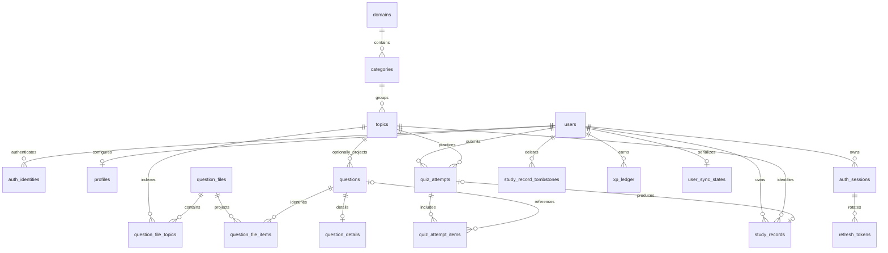

# 뽑공 서비스 DB·JSON 저장 구조 명세 v2.0

- 작성일: 2026-11-07
- 개정: v2.0 — JSON 원본을 유지하면서 문제를 MySQL에 직접 적재하고, 계정·프로필·기록·XP·동기화 구조를 정의
- 상태: MySQL 기반 서비스 DB 명세. 기본 문제 직접 적재·조회와 이메일 가입·로그인 유지는 구현했으며, 나머지 업무 API와 AWS 배포는 후속 작업
- 기준 자료: 첨부 SQL, GitHub `lrevin/Random-engineering`의 `feature/aws-backend` 브랜치 검토 결과
- 다른 세션의 문서·계획은 참고하지 않음
- 대상: AWS RDS for MySQL 8.4 LTS
- 변경 관리: 다음 주 LLM 응답 구조 확정 및 DB 연결 완료까지 초기 SQL을 보완하고, 이후 Flyway 마이그레이션으로 변경 이력을 관리하며 실제 서비스 준비
- 이 문서는 구조 명세이며, 실행 SQL은 api/mysql/schema-v2.sql, 실제 적용·검증 결과는 docs/JSON_BACKEND_VALIDATION.md와 docs/AUTH_MYSQL_VALIDATION.md에 별도로 기록

## 1. 적용 범위와 전제

이번 구조는 계정, 프로필, 주제, 문제와 문제 세부 내용, 퀴즈 제출, 학습 기록, AI 문제 수신·저장을 포함한다. 오프라인 학습과 기존 API 응답 형식을 유지하면서 서버 검증과 여러 기기 간 동기화를 지원한다.

앞선 검토의 권장안을 구현 기준으로 채택했다. 보관 기간·오프라인 경험치는 이번 요청에 따라 아래 정책을 채택했다. 미결정 사항은 15장에 분리한다. 기간은 서비스 운영 기본값이며 법적 의무 보존 기간을 뜻하지 않는다.

### 공통 규칙

- 모든 테이블: `ENGINE=InnoDB`, 기본 문자 집합 `utf8mb4`.
- 사용자 표시 문자열: 기본 `utf8mb4_0900_ai_ci` 사용 가능.
- UUID: `CHAR(36) CHARACTER SET ascii COLLATE ascii_bin`. API에서 소문자 표준 형식으로 검증·정규화. 참조하는 FK도 동일한 타입과 정렬 사용.
- 외부 제공자 식별자: 대소문자를 구분하는 정렬 사용. 해시: `BINARY(32)`.
- 시각: `DATETIME(3)`, UTC 저장. 모든 DB 연결의 세션 시간대를 `+00:00`으로 설정.
- `created_at`: 서버 생성 시각. `updated_at`: 서버가 실제 변경 시 갱신. 클라이언트 시각을 대입하지 않음.
- 논리 상태: `VARCHAR`와 `CHECK` 사용. 값 추가는 마이그레이션으로 관리.
- JSON은 API의 스키마 검증과 DB의 자료형·배열 제약을 함께 적용. 존재하는 마스터 코드인지는 관계 테이블 또는 API에서 검증.
- 아래에 별도 표시하지 않은 컬럼은 `NOT NULL`. `?`는 NULL 허용.
- FK 삭제는 기본 `RESTRICT`. 사용자 소유 데이터만 명시적으로 `CASCADE` 적용.
- 클라이언트가 보낸 사용자 ID를 신뢰하지 않고 인증 토큰의 사용자 ID로 소유권 결정.

## 2. 테이블 관계



## 3. 계정과 인증

계정(users), 로그인 수단(auth_identities), 로그인 세션(auth_sessions), 회전 토큰(refresh_tokens)의 역할을 분리한다. 아래 필수값·CHECK는 DB에서, 소유권·인증·상태 전환은 서버에서 검사한다.

### users — 서비스 계정

| 컬럼 | 타입 | 설명 |
|---|---|---|
| id | UUID, PK | 서비스 사용자 ID |
| status | VARCHAR(16) | active=정상 / deleting=탈퇴 예약, 기본 active |
| auth_version | INT UNSIGNED | 계정 전체 Access Token 무효화용 번호, 기본 1, CHECK 1 이상 |
| email_verified_at | DATETIME(3), NULL 허용 | 이메일 로그인 주소의 실제 인증 완료 시각 |
| phone_verified_at | DATETIME(3), NULL 허용 | 휴대폰 인증 완료 시각, 현재 미구현이면 NULL |
| created_at | DATETIME(3) | 가입 시각 |
| updated_at | DATETIME(3) | 계정 정보 마지막 변경 시각 |
| deletion_requested_at | DATETIME(3), NULL 허용 | 탈퇴 요청 수락 시각, 7일 유예 기준 |

- CHECK: active이면 deletion_requested_at=NULL, deleting이면 NOT NULL이며 그 외 status는 허용하지 않는다. 두 값은 항상 함께 변경한다.
- 탈퇴 신청 시 deleting 전환·신청 시각 기록·기존 세션 폐기를 함께 처리하고 일반 서비스 접근을 차단한다. 7일 전에는 별도 본인 인증으로 취소(active·NULL)할 수 있고, 7일 경과 후에는 데이터와 계정 행을 삭제한다. 삭제 작업 지연 중에도 취소·일반 접근은 허용하지 않는다.
- INDEX `(status, deletion_requested_at)`는 7일이 지난 탈퇴 예약 계정을 찾는 데 사용한다. 계정 삭제 후 신청 시각도 사라지며 영구 탈퇴 이력으로 보관하지 않는다.
- 인증 시각은 users에서만 관리한다. 이메일 인증 도입 전에는 NULL을 허용하고 도입 후 이메일 가입·연결은 선인증을 요구한다. 소셜 계정의 미제공 이메일과 미인증 휴대폰 때문에 컬럼 전체 NOT NULL 전환은 하지 않는다. 휴대폰 번호·인증 연동은 기능 도입 시 별도 확정한다.
- email_verified_at은 계정당 하나인 email 로그인 수단의 주소를 대상으로 한다. 해당 주소 변경·연결 해제 시 인증 상태도 함께 갱신·초기화하며 소셜 이메일만으로 인증 완료 처리하지 않는다.

#### auth_version 동작

- 로그인 시 현재 값을 JWT의 av에 넣고 인증 요청에서 users.status·auth_version을 확인한다. deleting은 일반 접근을 차단하고 av 불일치는 기존 토큰을 거절한다.
- 별도의 전체 Access Token 무효화가 필요할 때만 증가시킨다. 비밀번호 재설정은 이 값을 바꾸지 않고 모든 Refresh Token을 폐기하므로 기존 Access Token은 만료까지 유지된다.
- 한 기기 로그아웃도 해당 세션만 폐기한다. 세션을 별도로 조회하지 않는 기존 Access Token의 즉시 차단은 보장하지 않는다.

### auth_identities — 로그인 수단

| 컬럼 | 타입 | 설명 |
|---|---|---|
| id | UUID, PK | 로그인 수단 ID |
| user_id | UUID, FK users.id | 소유 계정, ON DELETE CASCADE |
| provider | VARCHAR(10) | email / kakao / apple |
| provider_subject | VARCHAR(255), binary 비교 | email은 정규화 이메일, 소셜은 제공자 고유 ID |
| email | VARCHAR(254), NULL 허용 | 로그인·연락용 이메일, email 제공자는 필수 |
| password_hash | VARCHAR(255), NULL 허용 | BCrypt 비밀번호 해시, email 제공자는 필수 |
| created_at | DATETIME(3) | 생성·연결 시각 |
| updated_at | DATETIME(3) | 로그인 수단 마지막 변경 시각 |

- UNIQUE `(provider, provider_subject)`와 `(user_id, provider)`: 제공자 계정의 중복 연결을 막고 사용자당 제공자별 로그인 수단을 하나만 허용한다.
- CHECK: provider는 email / kakao / apple만 허용하며 email은 email·password_hash 필수, kakao/apple은 password_hash=NULL이다. email의 provider_subject와 email 일치는 서버에서 검사한다.
- 이메일 정규화는 앞뒤 공백 제거·전체 소문자 변환으로 통일하고 내부 공백·잘못된 형식은 거절한다. 점·+tag는 제거하지 않으며 가입·로그인·재설정에서 같은 함수를 사용한다. 소셜 고유 ID에는 적용하지 않는다.
- 비밀번호는 영문 대문자·소문자·숫자·특수문자를 모두 포함하여 8자 이상이며 BCrypt 입력 제한에 맞춰 UTF-8 기준 72바이트 이하로 제한한다. 원문은 저장·로그 출력하지 않는다.
- 소셜 이메일에는 전역 UNIQUE를 걸지 않고 이메일 일치만으로 계정을 합치지 않는다. 로그인 수단 연결·해제는 본인 인증을 거치며 마지막 수단은 해제할 수 없다. 카카오 계정에 비밀번호를 추가하려면 같은 사용자에 email 로그인 수단을 연결한다.

### auth_sessions — 로그인 세션

| 컬럼 | 타입 | 설명 |
|---|---|---|
| id | UUID, PK | 한 번의 로그인에서 발급·갱신한 토큰을 묶는 ID |
| user_id | UUID, FK users.id | 소유 계정, ON DELETE CASCADE |
| created_at | DATETIME(3) | 로그인 세션 생성 시각 |
| expires_at | DATETIME(3) | 갱신으로 연장하지 않는 세션 절대 만료 시각 |
| revoked_at | DATETIME(3), NULL 허용 | 로그아웃·재사용 탐지 등으로 세션을 폐기한 시각 |

- INDEX `(user_id, revoked_at)`, `(expires_at)`. 같은 기기에서도 다시 로그인하면 별도 세션을 만들 수 있으며 물리 기기 ID로 사용하지 않는다.
- Refresh 요청은 토큰뿐 아니라 세션의 만료·폐기와 계정 상태도 확인한다. 새 토큰 만료는 세션 만료를 넘길 수 없다.

### refresh_tokens — 회전 토큰 이력

| 컬럼 | 타입 | 설명 |
|---|---|---|
| token_hash | BINARY(32), PK | 무작위 Refresh Token의 SHA-256, 원문 저장 금지 |
| session_id | UUID, FK auth_sessions.id | 로그인 세션 연결, ON DELETE CASCADE |
| created_at | DATETIME(3) | 발급 시각 |
| expires_at | DATETIME(3) | 개별 토큰 만료 시각 |
| consumed_at | DATETIME(3), NULL 허용 | 새 토큰 발급에 사용되어 효력이 끝난 시각 |
| revoked_at | DATETIME(3), NULL 허용 | 로그아웃·보안 조치 등으로 강제 폐기한 시각 |

- INDEX `(session_id)`, `(expires_at)`. 순번 컬럼 없이 같은 session_id로 회전 이력을 묶는다.
- 갱신 시 사용자 상태·세션을 잠금 순서에 맞춰 확인하고 기존 토큰의 만료·폐기·미사용 여부를 재검사한다. 기존 토큰 소비와 새 토큰 생성을 같은 트랜잭션으로 처리한다.
- 소비된 토큰은 즉시 지우지 않고 활성 세션 동안 유지하며 세션 종료(만료·폐기 중 먼저 발생) 후 30일에 정리한다. 앱은 갱신 요청을 한 번에 하나만 실행하고, 소비된 토큰 재사용에 대한 세션 폐기·네트워크 재시도 유예는 백엔드 계약에서 확정한다.

## 4. 프로필과 주제

### profiles — 사용자 설정

| 컬럼 | 타입 | 설명 |
|---|---|---|
| user_id | UUID, PK/FK users | ON DELETE CASCADE |
| nickname | VARCHAR(20) | 1~20자, 공백만 입력 금지 |
| interests | JSON | 관심 category ID 배열, 초기에는 JSON 유지 |
| level | TINYINT UNSIGNED | 선호 난이도, 0~3 |
| study_minutes | SMALLINT UNSIGNED | 1~120 |
| reminder_enabled | BOOLEAN | CHECK 0 또는 1 |
| reminder_time | CHAR(5), ASCII | HH:MM, 00:00~23:59, 기본값 '21:00', 사용자 변경 가능 |
| created_at | DATETIME(3) | 생성 |
| updated_at | DATETIME(3) | 변경 |

- 관심 분야 ID의 실제 존재 여부·중복·허용 개수는 API 서버에서 검사한다.
- 이번 프로젝트의 서비스 기준 시간대는 `Asia/Seoul`(한국 표준시, UTC+9)로 고정한다. 기본 reminder_time값은 21:00로 설정하며 사용자가 변경할 수 있다.
- 알림 설정 저장과 실제 알림 발송은 별도 기능이며, 서버 푸시 알림 발송은 현재 구현 범위에 포함하지 않는다.

### domains — 분야

| 컬럼 | 타입 | 설명 |
|---|---|---|
| id | VARCHAR(32), PK, binary 비교 | it 등 상위 분야 코드 |
| name_ko | VARCHAR(100) | 한글 표시 이름 |
| is_active | BOOLEAN | CHECK 0 또는 1 |
| created_at | DATETIME(3) | 생성 |
| updated_at | DATETIME(3) | 변경 |

- 분야 → 세부 분야 → 주제의 3단계 계층으로 관리한다. 예: IT → 운영체제 → 교착 상태. 
- is_active는 해당 분야·세부 분야·주제의 활성/비활성화 여부를 나타내며, 0이면 기존 학습 기록은 유지하되 신규 선택·출제에서 제외한다.
- 참조 중인 분야는 물리 삭제하지 않고 비활성화한다.

### categories — 세부 분야

| 컬럼 | 타입 | 설명 |
|---|---|---|
| id | VARCHAR(32), PK, binary 비교 | 앱의 기존 관심 분야 코드, 세부 분야의 전역 고유 ID |
| domain_id | VARCHAR(32), FK domains.id, binary 비교 | 소속 분야, ON DELETE RESTRICT |
| name_ko | VARCHAR(100) | 한글 표시 이름 |
| is_active | BOOLEAN | CHECK 0 또는 1 |
| created_at | DATETIME(3) | 생성 |
| updated_at | DATETIME(3) | 변경 |

- INDEX `(domain_id, is_active)`. domain_id는 domains.id와 문자 집합·정렬을 동일하게 맞춘다. 기존 category ID는 유지하며 소속 분야는 FK로 검증한다. 참조 중인 세부 분야는 물리 삭제하지 않고 비활성화한다.
- 분야가 비활성화되면 하위 세부 분야·주제도 신규 선택·출제에서 제외한다. 하위 행의 is_active를 일괄 변경하지 않고 조회 시 상위 분야 상태를 함께 검사한다. 과거 학습 기록은 유지한다.

### topics — 학습 주제

| 컬럼 | 타입 | 설명 |
|---|---|---|
| id | VARCHAR(32), PK, binary 비교 | os-07 등 기존 코드 |
| category_id | VARCHAR(32), FK categories | 소속 분야 |
| name_ko | VARCHAR(100) | 주제 이름 |
| difficulty | TINYINT UNSIGNED | CHECK 1~3 |
| is_active | BOOLEAN | CHECK 0 또는 1 |
| created_at | DATETIME(3) | 생성 |
| updated_at | DATETIME(3) | 변경 |

- INDEX `(category_id, is_active, difficulty)`. 참조된 주제는 물리 삭제하지 않고 비활성화한다. 초기 배포 전에 기존 앱 코드와 분류 코드를 대조하여 테이블 등록
- 주제의 기준 학습 수준. 기존 앱의 Topic.lv 값을 저장하며, 1=기초·2=중급·3=심화이다. 해당 주제의 문제는 이 수준에 맞춰 작성·생성한다.

## 5. JSON 문제 원본과 MySQL 직접 적재

### 저장소 실측 결과

2026-11-07 `feature/aws-backend` 체크아웃 기준, 기본 문제는 `app/src/data/quizbank/*.json` 21개, 220개 주제, 5,520문제이다. 전체 주제 마스터는 1,054개다. 주제 마스터에 있다고 기본 문제가 모두 준비된 것은 아니다.

- 기본 JSON은 `os-1.json` 같은 분야·묶음 단위 파일이다. `{ "os-01": [...], "os-02": [...] }` 형식으로 한 파일에 여러 주제가 들어간다. 주제당 파일 하나라고 가정하지 않는다.
- 같은 주제가 여러 파일에 나뉠 수 있으며 모든 배열을 병합한다. 뒤 파일로 덮어쓰지 않는다.
- AI JSON은 `api/quiz-server/data/pools/<topicId>.json`에 주제별 배열로 저장한다. 각 문제에 `reviewed`, `model`, `createdAt`, `served`가 추가된다.
- 기존 JSON은 문제 작성·전달용 원본으로 보존한다. 기본 문제는 검증·변환 후 MySQL에 문제별 행으로 직접 저장하며, 서비스 문제 조회는 DB를 기준으로 한다. 중간 행 형식 JSON 파일은 생성하지 않는다.

### 기본 문제의 실제 형식

```json
{
  "os-01": [
    {
      "type": "mc",
      "q": "운영체제가 실행 중인 프로그램을 관리하는 단위는?",
      "choices": ["컴파일러", "라이브러리", "소스 코드", "프로세스"],
      "answer": 3,
      "explain": "프로세스는 실행 중인 프로그램의 관리 단위입니다."
    }
  ]
}
```

객관식은 보기 4개, 중복 없는 비어 있지 않은 문자열, 정답은 0~3 정수다. OX는 choices 없이 boolean 정답을 저장한다. 문장·해설은 각각 1~400자, 보기 각각 1~200자다. 허용되지 않은 주제, 깨진 JSON, 잘못된 정답·중복 문제는 검증에서 실패한다. 저장 규격 검증은 내용의 사실성 검수를 대신하지 않는다.

### 파일·버전 관리

기본 문제의 원본 버전은 Git commit과 파일 SHA-256으로 추적한다. 운영에 반영한 파일은 별도의 배포 버전으로 보존하고 수정 시 새 버전을 배포한다. AI pool은 계속 변경되는 현재 작업본이므로 원자적으로 파일을 교체하고, 배포·DB 적재 시 별도의 불변 사본과 체크섬을 생성한다. served는 서비스 횟수이며 정답 내용 버전에서 제외한다.

운영 초기에는 단일 AI 쓰기 프로세스와 영구 디스크를 사용한다. 프로세스 내부 주제 잠금은 다중 서버 동시 쓰기를 보호하지 못한다. 다중 서버·S3 전환 시 조건부 갱신과 버전 관리를 추가한다. JSON을 DB 안에 통째로 중복 저장하지 않는다.

### question_files — 원본 파일 버전 색인

| 컬럼 | 타입 | 설명 |
|---|---|---|
| id | UUID, PK | 파일 버전 ID |
| source | VARCHAR(4) | bank / ai |
| storage_key | VARCHAR(512), binary 비교 | 배포 내 상대 경로 또는 영구 저장소 객체 키 |
| sha256 | BINARY(32) | 보관한 파일 바이트 체크섬 |
| status | VARCHAR(12) | draft / published / disabled |
| question_count | INT UNSIGNED | 파일 전체 문제 수 |
| schema_version | SMALLINT UNSIGNED | 원본 규격 버전, 초기 1 |
| created_at | DATETIME(3) | 파일 버전 등록 시각 |

UNIQUE `(storage_key, sha256)`. 기본 문제 적재 명령이 파일 버전과 공개 상태를 등록하며, MySQL 모드의 API는 공개된 파일 버전에 연결된 문제를 조회한다. 운영자용 파일 등록·공개 전환 API는 후속 구현이다. 상대 경로를 사용자 입력으로 받아 파일에 직접 접근하지 않는다.

### question_file_topics — 파일과 주제의 다대다 색인

| 컬럼 | 타입 | 설명 |
|---|---|---|
| file_id | UUID, FK question_files | 파일 버전, ON DELETE CASCADE |
| topic_id | VARCHAR(32), FK topics.id | 주제 ID, ON DELETE RESTRICT |
| question_count | INT UNSIGNED | 해당 파일·주제의 문제 수 |

PK `(file_id, topic_id)`, INDEX `(topic_id)`. 전체 DB 구축 시 topics를 먼저 생성하고 topic_id에 FK를 설정한다. 기본 문제 적재 시 앱의 분야·세부 분야·주제 코드를 DB에 등록하고 topics.json과 대조한다. DB 설정이 없는 JSON 실행 모드에서는 topics.json으로 주제 존재 여부를 검사한다. 한 주제·출처에 여러 공개 파일을 함께 허용하고 병합하되, 같은 storage_key의 복수 버전을 동시에 공개하지 않는다. 버전 교체는 트랜잭션으로 수행한다.

### questions — 문제 식별 정보

| 컬럼 | 타입 | 설명 |
|---|---|---|
| id | UUID, PK | 출처·주제·정규화 내용의 SHA-256 기반 UUIDv8 |
| topic_id | VARCHAR(32), FK topics.id | 주제 ID, ON DELETE RESTRICT |
| source | VARCHAR(4) | bank / ai |
| status | VARCHAR(12) | draft / published / disabled |
| content_hash | BINARY(32) | 정규화 내용 해시 |
| created_at | DATETIME(3) | 생성 |
| updated_at | DATETIME(3) | 변경 |

UNIQUE `(topic_id, source, content_hash)`, INDEX `(topic_id, source, status)`. 기존 원본에 ID가 없으므로 파일명·배열 위치가 아닌 내용으로 식별한다. 배열 순서·파일 이동·JSON 키 순서가 바뀌어도 동일 ID다. 정답·해설·보기 순서 등 내용이 바뀌면 새 ID를 만든다. 과거 ID를 재사용해 내용을 덮어쓰지 않는다. ID 생성 규칙 버전 변경은 별도 마이그레이션으로 처리한다. 기기에서만 만든 offline 연습 문제는 중앙 questions에 적재하지 않고 snapshot으로 보존한다.

### question_details — 문제별 내용

| 컬럼 | 타입 | 설명 |
|---|---|---|
| question_id | UUID, PK/FK questions | ON DELETE CASCADE |
| type | VARCHAR(2) | mc / ox |
| body | TEXT | 원본 q |
| choices | JSON, NULL 허용 | mc 배열, ox NULL |
| answer | JSON | mc 0~3 정수 / ox boolean |
| explanation | TEXT | 원본 explain |
| model | VARCHAR(100), NULL 허용 | AI 모델, 기본 문제 NULL |
| created_at | DATETIME(3) | 생성 |
| updated_at | DATETIME(3) | 등록·변경 시각 |

검증한 문제 문장·보기·정답·해설을 MySQL에 저장하고 서비스 API가 조회한다. 내용 수정은 JSON 원본 수정·재적재로 반영하여 원본과 DB가 달라지지 않게 한다. 문제와 세부 내용은 같은 트랜잭션으로 적재하며, 연결된 파일 버전과 문제의 status가 모두 published일 때만 제공한다. 기존 JSON 실행 모드는 DB 설정이 없는 개발 환경의 보조 경로로 유지한다.

### question_file_items — 원본 위치와 DB 문제 연결

| 컬럼 | 타입 | 설명 |
|---|---|---|
| file_id | UUID | 파일 버전 |
| topic_id | VARCHAR(32) | 파일 내 주제 |
| position | INT UNSIGNED | 해당 배열 내 위치, 1부터 시작 |
| question_id | UUID, FK questions | DB에 저장된 문제 |

PK `(file_id, topic_id, position)`. `(file_id, topic_id)`는 question_file_topics 참조. 위치는 추적용이며 문제의 고정 ID가 아니다. 동일한 DB 문제 행은 여러 원본 버전에서 재사용할 수 있다.

### API 호환과 단계적 전환

MYSQL_USER가 설정된 현재 `GET /quiz-bank/:topicId`는 MySQL의 questions·question_details와 공개 파일 연결을 조회하여 `{ questions: [...] }`를 제공한다. 활성 분야·세부 분야·주제에 속하며 문제와 파일 버전이 모두 published인 기본 문제만 제공한다. 알려진 활성 주제에 문제가 없으면 빈 배열, 없거나 비활성인 주제는 404다. DB 설정이 없으면 기존 JSON 모드를 지원한다. 응답은 오프라인 학습을 위해 정답·해설을 포함하며 서버 채점용 출제 계약과 다르다. 적재 전 JSON 전체를 검증하며, DB 연결 실패 시 JSON으로 자동 대체하지 않는다.

기존 quiz_bank·ai_quizzes 테이블은 초기 초안이다. 운영 데이터가 있다면 백업·대조 후 원본 파일로 이관하고 쓰기를 중단한다. 무조건 삭제하지 않는다. 기본 문제는 현재 적재 명령으로 questions/question_details에 직접 저장하고 MySQL 문제 API로 조회할 수 있다. 앱은 서버 연결이 없으면 내장 문제·캐시를 사용할 수 있으므로 DB가 앱 실행의 필수 조건은 아니다.

## 6. 퀴즈 시도와 제출

### quiz_attempts — 퀴즈 수행 단위

| 컬럼 | 타입 | 설명 |
|---|---|---|
| id | UUID, PK | 클라이언트 생성 가능, 소유권 고정 |
| user_id | UUID, FK users | ON DELETE CASCADE |
| topic_id | VARCHAR(32), FK topics | 학습 주제 |
| status | VARCHAR(12) | issued / completed / abandoned |
| verification_status | VARCHAR(20) | server_verified / client_reported |
| started_at | DATETIME(3) | 시작 시각 |
| completed_at | DATETIME(3), NULL 허용 | 완료 시각 |
| created_at | DATETIME(3) | 서버 수신 시각 |

- INDEX `(user_id, created_at, id)`. 
- 온라인은 서버가 출제 목록을 확정한다. 오프라인 제출은 출처·문제 ID·snapshot의 형식을 검사하되 서버 검증 완료로 자동 승격하지 않는다.
- status: 퀴즈의 진행 상태로, issued는 출제 후 풀이 가능, completed는 제출·채점 완료, abandoned는 중단되어 제출 불가를 의미한다.
- verification_status: 결과의 검증 방식으로, server_verified는 서버가 출제 당시 정답으로 직접 채점한 결과, client_reported는 앱이 채점해 전송한 점수를 서버가 직접 확인하지 못한 결과를 의미한다.

### quiz_attempt_items — 출제 문제와 사용자 답

| 컬럼 | 타입 | 설명 |
|---|---|---|
| attempt_id | UUID, FK quiz_attempts | ON DELETE CASCADE |
| position | TINYINT UNSIGNED | 출제 순서 1~7 |
| question_id | UUID, FK questions.id, NULL 허용 | 서버에 등록된 문제, ON DELETE RESTRICT |
| question_snapshot | JSON | 출제 당시 유형·문장·보기·정답·해설·개별 출처 및 주제 이름·난이도·분류를 보존 |
| submitted_answer | JSON, NULL 허용 | 사용자가 실제로 고른 답. 객관식은 보기 위치, OX는 true / false, 미응답은 NULL |
| is_correct | BOOLEAN, NULL 허용 | 미채점은 NULL, 그 외 0/1 |
| answered_at | DATETIME(3), NULL 허용 | 답변 시각 |

- PK `(attempt_id, position)`. 
- 모든 항목에 question_snapshot을 저장한다. 온라인 출제 구현 시 서버가 MySQL에 저장된 해당 버전의 문제에서 읽어 snapshot을 확정하고 이후 이를 수정하지 않는다. snapshot의 정답은 서버에만 보관하고 풀이 전 앱 응답에서는 제외한다. 
- 채점·과거 조회는 현재 JSON 파일이나 question_details가 아닌 출제 당시 snapshot을 사용한다. 완료 후 답안·정오답은 일반 수정 불가. 문제 FK가 있는 과거 시도는 문제 물리 삭제를 제한한다.

## 7. 학습 기록

### study_records — 완료된 학습 기록

퀴즈 한 번의 완료 결과와 학습 메모·시간·확정 경험치를 저장한다. 문제별 내용·선택 답·정오답은 quiz_attempt_items에서 관리한다.

| 컬럼 | 타입 | 설명 |
|---|---|---|
| id | UUID, PK | 학습 기록 ID, 앱에서 생성 가능 |
| user_id | UUID, FK users.id | 기록 소유 사용자, ON DELETE CASCADE, 소유자 변경 불가 |
| attempt_id | UUID, FK quiz_attempts.id, UNIQUE | 완료된 퀴즈 시도 연결, 시도 하나당 기록 최대 1건, ON DELETE RESTRICT |
| topic_id | VARCHAR(32), FK topics.id | 학습 주제, ON DELETE RESTRICT |
| topic_ko | VARCHAR(100) | 학습 당시 주제 이름, 이후 주제명 변경에도 과거 표시 유지 |
| domain | VARCHAR(32) | 학습 당시 상위 분야 코드, 기존 API 호환용 snapshot |
| category | VARCHAR(32) | 학습 당시 세부 분야 코드, 기존 API 호환용 snapshot |
| difficulty | TINYINT UNSIGNED | 학습 당시 주제 난이도, 1=기초 / 2=중급 / 3=심화 |
| memo | TEXT | 사용자 학습 메모, 최대 5,000자, 오프라인 수정은 기기에 보관하고 재연결 시 동기화 |
| score | TINYINT UNSIGNED | 맞힌 문제 수, 0~quiz_total |
| quiz_total | TINYINT UNSIGNED | 추후 변경 고려, 현재 서비스는 7문제 고정 |
| rp | SMALLINT UNSIGNED | 서버가 확정한 최초 지급 경험치, 기존 API 이름 유지 |
| study_sec | INT UNSIGNED | 공부 시간, 초 단위 |
| studied_at | DATETIME(3) | 학습 완료 시각, UTC 저장 |
| study_date | DATE, NULL 허용 | Asia/Seoul 기준 연속 학습 인정 날짜, 시각 미인정이면 NULL |
| time_validation_status | VARCHAR(16) | accepted=허용 시각 / needs_review=미래 시각 오류 등으로 날짜 인정 보류 |
| submission_hash | BINARY(32) | 같은 기록 ID의 완료 요청 재전송 시 내용 변경 여부 확인 |
| change_seq | BIGINT UNSIGNED | 기기 간 변경 전달용 사용자별 순번, 메모 저장 시 해당 기록의 수정 전 순번과 비교하여 충돌 검사 |
| received_at | DATETIME(3) | 최초 완료 요청의 서버 접수 시각, 재전송으로 변경 금지 |
| created_at | DATETIME(3) | 최초 서버 저장 시각 |
| updated_at | DATETIME(3) | 마지막 서버 변경 시각 |

#### 오프라인 기록 변경 가이드

- 메모는 오프라인에서도 기기에 저장하고, 인터넷 재연결 시 서버에 반영한다. 전송 실패 시 로컬 메모를 유지한다.
- 저장할 때 해당 기록의 수정 전 change_seq를 비교한다. 다른 기기에서 변경됐다면 자동으로 덮어쓰지 않고 사용자에게 선택하게 한다.
- 서버 반영이 확인된 메모만 동기화 완료로 처리한다. 전송 중 추가한 수정은 유지하며, 서버 조회로 미전송 메모를 덮어쓰지 않는다.
- 기록 삭제는 온라인에서만 허용한다. 서버에서 삭제된 기록은 메모 동기화로 복원하지 않고, 남은 로컬 메모는 초안으로 보존한다.

#### 조회와 API 응답

학습 당시 주제 정보는 기록에 보존한다. 아래 데이터는 연결된 테이블에서 조회하거나 계산하여 응답한다.

| 응답 데이터 | 기준 |
|---|---|
| 문제별 풀이 | quiz_attempt_items의 답안·채점 결과·question_snapshot |
| 오답 배열(wrong) | quiz_attempt_items에서 is_correct=0인 항목의 question_snapshot으로 문제·정답·해설을 구성. 오답이 없으면 빈 배열이며 study_records에 별도 컬럼을 두지 않음 |
| 대표 출처(quizSource) | quiz_attempt_items.question_snapshot의 개별 출처에서 계산 |
| 검증 상태 | quiz_attempts.verification_status |
| XP 계산 규칙 버전 | 해당 기록의 xp_ledger 지급 행(award)의 rule_version |

기존 API의 total은 quiz_total에, level은 difficulty에 대응하며 rp 이름은 유지한다.

#### DB 제약과 트랜잭션

- 값 제한: score 0~7, quiz_total=7(기본값 7), rp 0~1000, difficulty 1~3, memo 최대 5,000자, study_sec≥0.
- 인덱스: INDEX `(user_id, studied_at, id)`, UNIQUE `(attempt_id)`, UNIQUE `(user_id, change_seq)`. PK·FK·NULL 허용 여부는 위 컬럼 표를 따른다.
- 완료 시 사용자·주제·시도와 7개 답안을 확인하고, 완료 전환·기록 생성·XP 지급·변경 순번 발급을 하나의 트랜잭션으로 처리한다. 삭제 시에도 기록·연결 답안 삭제와 XP 취소·삭제 표식 생성을 함께 커밋한다.

### 기록 저장 규칙

1. 요청의 user_id는 사용하지 않고 토큰의 사용자로 고정한다.
2. 최초 생성 시 topic·문제·점수·경험치와 제출 해시를 검증한다.
3. 동일 id·동일 소유자·동일 최초 제출 해시는 기존 결과를 반환하고 경험치를 추가 지급하지 않는다. 동일 id로 완료 내용이 달라지면 거절한다. 완료 요청 재전송으로 기존 메모를 덮어쓰지 않으며, 메모 변경은 별도 수정 요청으로 처리한다.
4. 다른 사용자 소유 id와 충돌하면 거절한다. 무조건 upsert로 덮어쓰지 않는다.
5. 완료 후 점수·경험치·주제·학습 시각은 일반 수정 불가. 메모는 오프라인 수정·재연결 후 반영을 허용하며, 기준 순번 비교와 충돌 시 사용자 선택을 적용한다. 자동 덮어쓰기·자동 병합은 하지 않는다.
6. 사용자 잠금·접근 가능 상태·소유권을 확인하고, 현재 메모와 요청 메모가 같으면 변경 없이 반환한다. 내용이 다른 경우 기준 순번이 일치할 때만 짧은 트랜잭션에서 memo·updated_at·새 change_seq를 함께 갱신한다. DB 잠금은 저장 중에만 적용하며 편집 화면을 열어 둔 동안 유지하지 않는다.
7. 기록 삭제 시 study_records와 연결된 quiz_attempt_items를 제거하고 별도 tombstone을 90일 유지한다. 완료된 quiz_attempts는 중복 제출 방지를 위해 탈퇴 시까지 보존하며, 이미 완료된 attempt_id로 새 기록을 만들 수 없다. 표식 만료 후에도 XP 원장의 지급 기록 ID를 확인하여 재접수·재지급을 거절한다.
8. 최초 제출 해시는 채점·완료 불변 필드만 포함하고 가변 메모는 제외한다. 정규화 직렬화 규칙은 API 계약으로 고정한다.
9. 첫 클리어·복습 배율은 사용자 잠금 안에서 서버 수락 순서와 XP award 이력을 기준으로 확정한다. 기록·XP 원장은 같은 트랜잭션으로 저장한다.

## 8. 경험치

### xp_ledger — 경험치 지급·취소 원장

| 컬럼 | 타입 | 설명 |
|---|---|---|
| id | UUID, PK | 원장 ID |
| user_id | UUID, FK users | ON DELETE CASCADE |
| source_record_id | UUID | 원본 기록 ID, 삭제 뒤에도 유지하므로 FK 없음 |
| topic_id | VARCHAR(32), FK topics | 보너스·복습 판정용 주제 |
| event_type | VARCHAR(10) | award / reversal |
| amount | INT | 지급 양수 또는 0, 취소 음수 또는 0 |
| reverses_entry_id | UUID, NULL 허용, UNIQUE | 취소 대상 award ID |
| rule_version | VARCHAR(32) | 계산 규칙 버전 |
| verification_status | VARCHAR(20) | server_verified / client_reported |
| calculation_details | JSON | 계산 근거 - 기본·만점·첫 클리어·복습·연속 보너스 계산 근거, 학습 원문 제외 |
| idempotency_key | VARCHAR(128), binary 비교, UNIQUE | 지급·취소 중복 방지 고유키 |
| created_at | DATETIME(3) | 확정 시각 |

- UNIQUE `(user_id, source_record_id, event_type)`, INDEX `(user_id, created_at, id)`, INDEX `(user_id, topic_id, event_type)`.
- award는 amount >= 0이고 reverses_entry_id가 NULL, reversal은 amount <= 0이고 대상 ID 필수. 대상은 같은 사용자·같은 원본의 award여야 하고 금액은 정확히 반대인지 트랜잭션에서 검사한다.
- 0 XP 기록도 award를 생성한다. 원장은 일반 수정하지 않는다. 기록 생성·지급은 같은 트랜잭션, 기록 삭제·취소도 같은 트랜잭션이다.
- study_records.rp는 최초 지급 확정값의 API 호환용 사본이다. 누적 XP의 기준은 원장 합계다.
- 삭제한 기록의 XP는 한 번만 취소하고 다른 기록의 과거 XP는 재계산하지 않는다. 삭제 시 레벨이 내려갈 수 있음을 안내한다.
- 삭제 후에도 첫 클리어·복습 판정에 award 이력을 포함한다. 삭제로 보너스 기회를 복원하지 않는다.
- 표식 만료 후에도 원장에 남은 record ID는 다시 생성할 수 없다. 새 UUID로 위장한 중복을 이것만으로 막을 수는 없다. 이미 완료된 attempt_id는 기록 삭제 후에도 보존하여 새 기록 생성에 재사용하지 못하게 한다.
- 원장은 탈퇴 시까지 유지하고 탈퇴 시 삭제한다. 자기참조 FK는 두지 않고 취소 대상 정합성을 서버에서 검사한다.

### RP 계산 공식 — GitHub 구현 기준

- 정답 1개당 XP: difficulty 1은 6, 2는 9, 3은 13.
- priorAttempts는 해당 주제의 이전 완료 award 수. 배율은 0회=1, 1회=0.7, 2회 이상=0.5.
- 기본 XP B = Math.round(score × 난이도별 XP × 복습 배율).
- 만점이면 Math.round(B × 0.2)를 추가한다.
- 첫 시도(priorAttempts=0)이며 정답률 60% 이상이면 difficulty ×10을 추가한다.
- streak가 3일 이상이면 Math.round(B × 0.1)를 추가한다.
- rp는 위 항목의 합계다. 각 보너스는 보너스를 더하기 전 기본 XP B를 기준으로 따로 반올림한다.
- 예: 중급 첫 시도, 7문제 만점, 3일 연속이면 B=63, 만점=13, 첫 클리어=20, 연속=6으로 총 102 XP.
- 레벨은 1부터 시작하며 다음 레벨 필요 XP는 50 + 10 × (현재 레벨 - 1), 최대 레벨 100이다. rp 컬럼의 '최초 지급'은 가입 보상이 아니라 해당 기록으로 처음 확정한 지급액을 뜻한다.
- 공식 출처: https://github.com/lrevin/Random-engineering/blob/feature/aws-backend/app/src/lib/rank.ts
- 서버 적용 기준: 첫 시도·복습은 사용자 잠금 아래 수락 순서로 확정한다. streak는 인정된 study_date까지 이어진 한국 날짜의 연속 일수이며 같은 날 여러 퀴즈는 날짜를 한 번만 센다. 날짜 미인정 기록은 streak=0으로 계산한다. 지연 제출로 이미 지급된 다른 기록의 XP를 재계산하지 않는다. 이는 서버 동기화 정책이며 계산 공식 자체와 구분한다.

### 오프라인 경험치 기본 정책

| 항목 | 정책 |
|---|---|
| 개인 기록·경험치·레벨·숙련도 | 오프라인도 인정 |
| 공개 랭킹·금전성 보상 | client_reported는 제외 |
| 확정 주체 | 서버가 점수·문제 수·주제 난이도 검증 후 계산, 요청 rp는 신뢰하지 않음 |
| 앱 표시 | 동기화 전 예상 XP, 서버 응답 후 확정 XP |
| 기본·만점 XP | 유효 점수와 서버 규칙으로 계산 |
| 첫 클리어 | 해당 주제 첫 시도에서 정답률 60% 이상인 경우에만 난이도 ×10 지급 |
| 복습 배율 | 서버 수락 순서의 과거 award 이력 기준 |
| 연속 학습 | 인정된 학습 날짜 기준 3일 이상 연속이면 기본 XP의 10%를 반올림하여 추가 |
| 지연 제출 | 이미 확정한 다른 기록의 XP를 소급 변경하지 않음 |

- 경험치 공식은 feature/aws-backend의 app/src/lib/rank.ts를 따른다. 첫 클리어·연속 보너스를 변경했던 이전 MD 제안은 취소한다. 서버 계산 규칙 식별자는 xp_ledger.rule_version으로 기록한다.
- 서버가 확정한 출제 당시 snapshot과 답안이 있으면 해당 snapshot으로 재채점한다. 외부 snapshot의 정답을 검증 근거로 신뢰하지 않으며 자체 신고 기록은 client_reported를 유지한다.
- 최초 접수보다 5분 초과 미래 시각은 needs_review, study_date는 NULL로 저장한다. 유효 점수의 개인 XP는 수락 순서로 확정하되 연속 학습·기간 보상에는 사용하지 않는다. 시각 정정은 명시적 서버 절차로만 허용한다.
- 최초 접수 기준 과거 30×24시간 이내 기록은 서비스 고정 시간대 Asia/Seoul 기준 study_date를 부여하고 연속 학습에 반영한다. 허용 범위인 미래 5분 이내 값은 날짜 판정에 min(studied_at, received_at)을 사용한다.
- 30일 초과 과거 기록도 기본·만점 XP를 인정한다. 첫 클리어 등은 과거 날짜가 아닌 현재 수락 순서로만 판정한다. study_date는 NULL로 두며 과거 연속 학습·기간 보상은 인정하지 않는다.
- 한 일괄 요청은 `(studied_at, id)`로 정렬하고 다른 요청·기기는 사용자 잠금 획득 순서로 직렬화한다.
- 클라이언트 시각과 UUID는 실제 학습을 증명하지 못한다. 서버 확정 계산과 server_verified 판정은 별개다.

### 누적 경험치와 숙련도 집계

누적 개인 XP는 xp_ledger의 amount 합계로, 숙련도는 서버의 전체 유효 학습 기록으로 계산한다. 최대 5,000건 등 앱의 목록 수신 제한으로 전체 통계를 계산하지 않는다. 집계 테이블은 초기에는 만들지 않고 필요 시 재생성 가능한 파생 데이터로 추가한다.

## 9. 동기화

### user_sync_states — 사용자별 변경 순번

| 컬럼 | 타입 | 설명 |
|---|---|---|
| user_id | UUID, PK/FK users | ON DELETE CASCADE |
| last_change_seq | BIGINT UNSIGNED | 마지막 발급 번호, 초기 0 |
| min_available_seq | BIGINT UNSIGNED | 증분 동기화가 유효한 최소 커서 |
| updated_at | DATETIME(3) | 변경 시각 |

동기화 누락을 피하기 위해 시각만으로 커서를 만들지 않는다. 기록을 생성·수정·삭제하는 트랜잭션은 이 사용자 행을 먼저 잠그고 순번을 발급한 뒤 기록을 저장·커밋한다. 같은 사용자의 변경 커밋 순서가 순번과 일치하게 한다. AI 호출 등 외부 작업은 이 트랜잭션에 넣지 않는다.

- 목록 조회: `(studied_at, id)` 기준 페이지네이션. 같은 시각의 기록도 id로 순서를 확정.
- 증분 동기화: study_records와 study_record_tombstones를 UNION ALL하고 `change_seq > cursor ORDER BY change_seq LIMIT n`으로 조회한다. 순번은 두 표에 걸쳐 같은 사용자 발급 절차로 유일하게 보장한다.
- 한 기록이 여러 번 바뀌면 최신 상태만 전달해도 되는 상태 동기화 모델. 전체 이벤트 이력이 필요하면 별도 로그 추가.
- 최초 동기화는 일관된 snapshot과 해당 순번을 함께 제공하거나 서버의 snapshot 페이지 토큰을 사용. 일반 페이지 조회를 순회하면서 순번만 읽는 구현은 금지. 초기 앱은 기록 화면 재진입·새로고침 시 서버 목록을 다시 조회하는 방식으로 시작할 수 있다. 상시 실시간 연결은 요구하지 않으며 증분 커서 계약은 유지한다.
- tombstone 정리와 min_available_seq 갱신은 함께 수행. 너무 오래된 커서는 전체 재동기화를 요구.
- 전체 재동기화 시 서버에 없는 로컬의 기존 동기화 완료 기록을 제거해야 삭제 데이터가 부활하지 않음.

### study_record_tombstones — 삭제 동기화 표식

| 컬럼 | 타입 | 설명 |
|---|---|---|
| user_id | UUID, FK users | ON DELETE CASCADE |
| record_id | UUID | 삭제 기록 ID, 원본에 FK 없음 |
| change_seq | BIGINT UNSIGNED | 사용자별 삭제 순번 |
| deleted_at | DATETIME(3) | 삭제 시각 |
| expires_at | DATETIME(3) | 삭제 후 90일 |

PK `(user_id, record_id)`, UNIQUE `(user_id, change_seq)`, INDEX `(expires_at)`. 메모·문제·점수·정답은 보관하지 않는다. 사용자 잠금 아래 학습 기록·연결 quiz_attempt_items 삭제·XP 취소·표식 생성을 함께 커밋한다. 완료된 quiz_attempts는 재사용 방지를 위해 보존한다. 만료 표식 정리와 min_available_seq 갱신도 사용자 잠금 아래 수행한다. 오래된 커서는 전체 재동기화하며 서버에서 삭제된 로컬 기록을 제거한다.

## 10. AI JSON 수신·저장과 문제별 행 가공

### 현재 구현

AI 서버는 기본 문제 은행과 기존 AI 문제를 참고하여 문제를 생성하고, 같은 서버에서 2차 검수까지 통과한 문제에 `reviewed: 2`를 기록한 뒤 주제별 JSON 배열 파일에 직접 저장한다. 검수 결과는 AI 서버 내부의 생성·검수·저장 흐름을 기준으로 인정한다. 향후 별도 전달 API를 구현하면 지정된 AI 생성 서버에서 인증된 경로로 전달했는지 확인하고, 수신 서버에서 JSON 형식과 필수값을 검증한 뒤 저장한다.

`model`, `createdAt`, `served`는 서버에서 관리한다. `served`는 해당 문제를 퀴즈 응답에 포함해 제공한 누적 횟수이며, 덜 제공한 문제를 우선 선택하는 데 사용한다. 앱 API 응답에는 퀴즈 표시에 필요한 `type`, `q`, `choices`(객관식), `answer`, `explain`만 포함한다.

저장은 같은 폴더의 임시 파일에 전체 배열을 완성한 뒤 rename한다. 손상 파일은 오류로 처리하고 빈 배열로 덮어쓰지 않는다. 주제당 저장 상한은 40개이며 fresh 요청도 이를 넘겨 생성하지 않는다. 이 상한은 토큰·비용 예산 자체를 보장하지 않는다. 생성 실패·검수 탈락도 비용을 소모할 수 있다.

### 향후 AI 문제의 MySQL 직접 수신

기본 문제와 AI 문제의 기존 필드 이름은 유지한다. 별도 AI 서버에서 문제를 전달받는 API는 주제 ID인 `topicId`와 문제 목록인 `questions`를 하나의 JSON 객체로 받는 방향으로 구성한다. 수신 API는 전달 서버의 인증과 주제·문제 형식을 확인한 뒤, `questions`의 문제들을 questions·question_details에 직접 저장한다. 중간 변환 JSON이나 주제별 파일을 다시 만드는 단계를 필수로 두지 않는다.

현재 AI 생성 서버의 JSON pool 저장은 유지하며, 이 MySQL 수신 경로는 아직 구현되지 않았다. LLM 응답 구조 확정 후 원본·버전 추적 정보, 검수 결과·model 매핑과 중복·공개 처리를 기존 문제 테이블 구조에 연결한다.

### 문제별 MySQL 직접 적재 절차

1. JSON 전체를 검증하고 주제 존재·객관식 정답·OX boolean·문제 중복을 확인한다.
2. q → body, explain → explanation, ox choices → NULL로 변환한다.
3. 출처·주제·정규화된 내용으로 결정적 UUIDv8과 content_hash를 계산한다. UUID가 같고 내용도 같으면 재적재를 생략한다. 내용이 다른 ID 충돌은 실패시킨다.
4. 원본 파일의 SHA-256·파일 버전·주제 색인·questions/question_details·원본 위치 연결을 하나의 DB 트랜잭션으로 등록한다. 원본 버전은 Git·배포 이력으로 별도 보존하며, DB에는 원본 전체나 중간 변환 JSON을 중복 저장하지 않는다. 재전송은 중복 등록·중복 공개되지 않아야 한다.
5. 새 버전 전체 검증 후 공개 대상을 한 번에 전환한다. 이전 버전은 출제를 중단하고 과거 snapshot을 유지한다. DB만 수정해서 원본과 달라지는 경로는 제공하지 않는다.

구현된 `api/server/import-bank.mjs`는 기본 JSON을 읽어 분류 마스터·파일 버전·주제 색인·questions/question_details·원본 위치를 MySQL에 직접 저장한다. 중간 행 형식 JSON 파일은 생성하지 않는다. 같은 버전 재적재는 중복 생성하지 않고, 새 파일 버전은 같은 트랜잭션에서 공개 전환한다. 기존 `npm run export`도 이제 DB 직접 적재 명령으로 연결된다. AI pool은 아직 JSON에 저장하며 AI 문제 수신·model 보존 적재는 LLM 전달 구조 확정 후 구현한다.

## 11. 삭제와 보존

이번 버전에서 채택한 서비스 운영 기본값이며 법적 의무 보존 기간을 뜻하지 않는다.

| 대상 | 기간 | 처리 |
|---|---|---|
| 계정·프로필 | 탈퇴 시까지 | 운영 DB에서 탈퇴 시 삭제 |
| 정상 학습 기록·메모·오답 | 사용자 삭제 또는 탈퇴 시까지 | 기간만으로 자동 삭제하지 않음 |
| 삭제한 학습 내용·연결 답안 | 삭제 트랜잭션에서 즉시 제거 | study_records·quiz_attempt_items 제거, 완료된 quiz_attempts는 탈퇴 시까지 보존 |
| 삭제 표식 | 삭제 후 90일 | ID·순번·시각만 유지 |
| XP 원장 | 탈퇴 시까지 | 기록 삭제 시 취소 행 추가 |
| 종료 세션·refresh token 이력 | 세션 종료 후 30일 | 활성 세션의 소비 토큰 이력은 유지 |
| 문제 JSON 원본·파일 버전·DB 문제 행 | 기본은 출제 중지로 관리 | 과거 풀이 내용은 출제 snapshot으로 보존, 참조 중인 문제 물리 삭제 금지 |
| AI 생성 작업 메타데이터 | 사용량 정산·진행 작업 관리에 필요한 동안 유지 | 문제별 생성 작업 FK 연결·출제 지침 버전·단계별 검수 이력은 초기 저장하지 않음 |
| AI 실패 로그·상세 오류 | 30일 | 원문·비밀 값 기록 금지 |
| RDS 자동 백업 | 14일 | 수동 snapshot 수명 주기는 별도 관리 |

AI 작업의 최소 상태·중복 방지 키·사용량 집계는 상세 오류 로그와 구분한다. 상세 오류를 제거해도 참조와 예약 정합성에 필요한 작업 메타데이터는 유지한다.

탈퇴 시 study_records → quiz_attempts/items → tombstones·xp_ledger → users와 나머지 소유 데이터를 명시적 트랜잭션 순서로 삭제한다. 여러 CASCADE 경로에만 의존하지 않는다.

백업은 만료 시점까지 삭제 전 데이터를 포함할 수 있다. 복원은 격리 환경에서 수행하고 백업 이후 삭제·탈퇴 요청을 재적용한 뒤 서비스에 연결한다. 재적용을 위한 최소 삭제 요청 목록은 운영 DB와 독립적으로 관리하며 대상 식별자·요청 시각만 저장한다. 저장소·접근권한·수동 백업을 포함한 만료 정책은 배포 전에 확정한다.

## 12. API와의 연결

| 기존 기능 | 적용 테이블·변경 |
|---|---|
| 회원가입·로그인 | users, auth_identities, auth_sessions, refresh_tokens |
| refresh·logout | 세션 단위 잠금·회전·폐기 |
| 프로필 | profiles, categories 코드 검증 |
| 문제 은행 조회 | 기본 JSON을 MySQL에 직접 적재하고 questions·question_details·공개 파일 연결로 조회, DB 미설정 시 JSON 모드 지원 |
| 퀴즈 시작·제출 | quiz_attempts, quiz_attempt_items, study_records |
| 기록 목록 | 커서 페이지네이션, 전체 조회 상한으로 통계 계산 금지 |
| 기록 동기화 | 사용자별 change_seq·삭제 표시·full-resync 계약 추가 |
| 기록 수정 | 완료 내용 불변, 메모는 오프라인 보관·재연결 전송, 기준 순번 충돌 시 사용자 선택 |
| 경험치·숙련도 | XP 원장 합계·전체 유효 기록 기반 서버 집계 응답 |
| 기록 삭제 | 원본·연결 답안 삭제 + XP 취소 + 표식 생성, 동일 트랜잭션 |

API JSON camelCase와 DB snake_case 변환은 서버에서 수행. 기존 total ↔ quiz_total, rp 이름은 유지한다. level은 difficulty에서 변환하고 wrong 응답 배열은 연결된 풀이에서 조합한다. DB에는 wrong 컬럼을 두지 않는다. 기존 기록 일괄 업로드 API는 호환 계층으로 유지하되 충돌·부분 실패 응답 계약을 명시해야 한다. 게스트 기록은 로그인 후 업로드 시 토큰 사용자의 소유로 생성하며 server_verified로 자동 승격하지 않는다.

## 13. 구축과 마이그레이션

1. MySQL 8.4 테스트 DB에 FK 의존 순서로 생성한다. question_details는 questions 생성 후 만들며 AI 생성 작업 테이블과 직접 FK로 연결하지 않는다.
2. LLM 응답 구조 확정·DB 연결 완료까지는 초기 생성 SQL을 직접 보완하고, 폐기 가능한 테스트 DB를 재생성하여 검증한다. 2주차 작업 때부터 Flyway 관리를 시작할 계획이며, 전환 시 초기 SQL을 V1__initial_schema.sql로 확정한다. 이후 공유·적용한 파일은 수정하지 않고 V2·V3 등 새 마이그레이션을 추가하며 이력·체크섬으로 관리한다. IF NOT EXISTS는 초기 설치 편의 기능일 뿐 기존 테이블을 변경하는 수단이 아니다.
3. domains → categories → topics 순서로 적재하고 기존 분야·관심 분야·주제 코드의 대응을 대조한다. categories.domain_id는 원본 분류의 상위 분야 코드에서 매핑하며 고아 참조를 검사한다.
4. 기존 계정에서 users와 auth_identities 분리. 이메일 정규화 충돌은 자동 병합하지 않고 별도 처리한다.
5. 기존 기본 문제 JSON 전체를 검증하고, 분류 마스터·question_files·주제 색인·questions/question_details·원본 위치 연결을 MySQL에 직접 적재한다. JSON 원본은 보존하며 중간 변환 JSON은 만들지 않는다. AI 문제 직접 적재는 LLM 전달 구조 확정 후 연결하며, 검수 근거가 없는 문제를 검수 통과로 간주하지 않는다.
6. 기존 DB 학습 기록이 있으면 현재 구조로 통일시키고 학습 이관·오답 호환 컬럼은 만들지 않는다. 신규 온라인·오프라인 제출을 모두 attempt/items와 연결한다.
7. 사용자 생성 시 동기화 상태를 초기화하고 각 완료 기록과 award를 원자적으로 생성한다. 같은 요청 재전송으로 중복 지급되지 않는지 검증한다.
8. 전환 중에는 쓰기 중지 또는 별도로 설계한 이중 쓰기·검증 절차를 사용한다. 구 테이블 제거는 호환 종료 후 수행한다.
9. 소유권 충돌, 동일 제출 재전송, refresh 동시 요청, 오프라인 메모 보존·재연결 반영·순번 충돌·응답 유실 재시도·전송 중 추가 수정·서버 삭제와의 충돌, AI JSON 중복 수신·저장, 삭제 동기화, 탈퇴, 백업 복구를 검증한다. XP 중복 지급·취소, 표식 만료 후 재전송, 5분·30일·90일 경계, 한국 시각 자정 경계, GitHub RP 공식 예시도 검증한다.

RDS 설정 기준: 퍼블릭 접근 끔, API 보안 그룹만 접속 허용, TLS 강제·인증서 검증, 저장 암호화, 자동 백업, 연결 풀 상한. API·AI 작업자·마이그레이션 계정의 테이블별 권한을 분리한다. API에 ppobgong.* 전체 CRUD를 일괄 부여하지 않는다.

## 14. 톱니바퀴 — 앱 내 재화

현재 코드에 구현된 동작을 정리한 것으로, 결제·서버 재화 정책이 확정된 상태는 아니다.

| 항목 | 현재 내용 |
|---|---|
| 용도 | 공부 시간 추가 |
| 최초 지급 | 30개 |
| 사용 비용 | 10개당 공부 시간 2분 연장 |
| 잔액 부족 | 시간 연장 불가 |
| 표시 위치 | 홈 화면·공부 시간 종료 안내창 |
| 저장·차감 | 앱 로컬 저장소 pg.gears에서 잔액을 읽고, 앱 내부에서 확인·차감·저장 |
| 기기 간 공유 | 서버 동기화가 없어 지원하지 않음 |
| 초기화 | 로컬 데이터 초기화 처리에서 기본값 30개로 복귀 |
| 결제 | 코드 주석에는 유료 재화로 표기되어 있으나 실제 결제 기능은 없음 |

추가 획득 방법·구매 가격·환급·서버 잔액 관리 정책은 아직 정의되지 않았다. 현재 DB 설계에는 톱니바퀴 관련 테이블을 포함하지 않는다.

결제 모델을 확정한 뒤, 그에 맞는 톱니바퀴 잔액·지급·사용 내역 관리 구조를 DB에 반영할 계획이다.

## 15. 별도 확정해야 할 정책

아래는 구조를 만들기 위한 논의 항목이며 확정값이 아니다.

| 항목 | 현재 제안·결정 필요 사항 |
|---|---|
| Multi-AZ·인스턴스 크기 | 허용 중단 시간·부하 시험·예산으로 확정 |
| 이메일 정규화 | 3장의 공통 함수 규칙 적용. 기존 데이터 전환 시 정규화 충돌 처리 검증 |
| 계정 연결 UI | 아래 연결 원칙을 구현할 제공자별 인증 화면과 해제 흐름 |
| 백업 복구 삭제 재적용 | 독립된 삭제 요청 목록의 저장소·권한·만료 정책 |
| refresh 재시도 | 네트워크 재전송 유예 허용 여부 |
| AI 기간별 예산 | 초기 구현 여부·관리 방식을 AI 담당자와 협의한다. 상세 예산 테이블 제안은 제외했다. |
| AI 추정 비용 | 추적 통화 USD, 모델별 단가표와 갱신 절차 확정. 초기 강제 차단은 호출·토큰 예산 기준 |
| 검수·수정 이력 확장 | 필요해지면 별도 설계. 현재는 JSON 원본·파일 버전과 MySQL 문제 행을 관리하며, 온라인 출제 도입 시 출제 snapshot으로 과거 내용을 보존 |
| reminder | 기기 로컬 알림 유지 여부, 서버 push 도입 시 기기 테이블 추가 |
| 요청·필드 상한 | 학습 기록 업로드 건수·본문 크기·학습 시간·AI 출력 길이를 백엔드 API 계약에서 확정 |

이 항목들이 결정되기 전에도 테이블별 DDL 초안 작성과 테스트 DB 검증은 진행할 수 있다. 

## 16. 구현 상태와 남은 작업

- 인증 구현: MySQL 기반 이메일 가입·로그인·로그아웃·JWT 확인·Refresh Token 회전을 구현했다. 모바일은 SecureStore로 로그인 정보를 유지한다. 이메일 선인증·비밀번호 재설정·소셜 로그인은 후속 구현이다.
- 업로드·동기화: 기록은 한 번에 최대 100회분씩 전송하고 항목별 성공 여부로 재시도하며, 통신 규칙 변경 시 syncVersion으로 구버전 처리 여부를 구분한다.
- 자동 정리: 만료 데이터·삭제 표식은 백엔드 예약 작업으로 매일 소량씩 정리하고, 탈퇴 신청 7일 후 삭제와 취소 요청이 겹쳐도 한 번만 처리되게 한다.
- 확장: 다중 서버 인증 상태 공유·운영자 권한 및 변경 이력은 해당 기능 도입 시 별도로 설계한다. 메모의 오프라인 수정·충돌 처리는 7장의 정책을 구현 대상으로 한다.


### 이번 코드의 범위

- 메모 오프라인 동기화: 7장의 로컬 영구 저장·대기 전송·기준 순번 검사·충돌 선택은 이번에 변경한 설계 정책이다. 앱·API 코드는 아직 이 정책에 맞게 수정하지 않았으며 기존 테스트 결과는 이 기능의 검증을 포함하지 않는다.

- 구현·실행 가능: 전체 19개 테이블 초기 SQL, 기본 JSON 검증·MySQL 직접 적재·파일 버전 공개 전환, MySQL 문제 조회 API(JSON 모드도 지원), AI 파일 원자적 저장·상한 처리, 앱의 문제 API 연결.
- 인증 API 구현: users·auth_identities·auth_sessions·refresh_tokens로 이메일 가입·로그인·세션 확인·회전·로그아웃을 처리한다. 비밀번호는 BCrypt 비용 12, Access Token은 HS256 JWT 15분, 세션은 연장 없는 30일이며 Refresh Token 원문은 DB에 저장하지 않는다. 가입 시 user_sync_states도 초기화한다.
- 후속 업무 API: 프로필·회원 탈퇴·퀴즈 시도·답안·학습 기록·XP 계산·동기화·정리 작업. 해당 테이블 생성과 SQL 테스트 통과를 API 완성으로 간주하지 않는다.
- 앱 연결: EXPO_PUBLIC_API_URL이 있으면 이메일 인증·로그인 유지·문제 조회는 MySQL API를 사용한다. 이 모드의 프로필·기록은 기기에만 보관하고 Supabase로 전송하지 않는다. 로그아웃 시 기기 내 계정별 보관본을 남기며 동일 계정 재로그인 시 복원한다. 기존 Supabase 계정·기록의 자동 이전은 하지 않는다. API URL이 없으면 기존 Supabase 경로를 유지한다.
- DDL: api/mysql/schema-v2.sql이 현재 전체 초기 스키마다. 기존 schema.sql·question-files.sql은 이전 초안으로 함께 실행하지 않는다. 사용자 생성 DB ppobgong의 MySQL 8.0.46에서 19개 테이블 생성·기본 문제 5,520개 적재·통합 테스트를 수행했다. MySQL 8.4·RDS 적용은 별도 검증 대상이며 Flyway 전환 전까지 초기 SQL을 보완한다.
- 모든 정책을 구현 완료로 간주하지 않는다. 다른 프로젝트 세션은 조회하지 않았다.