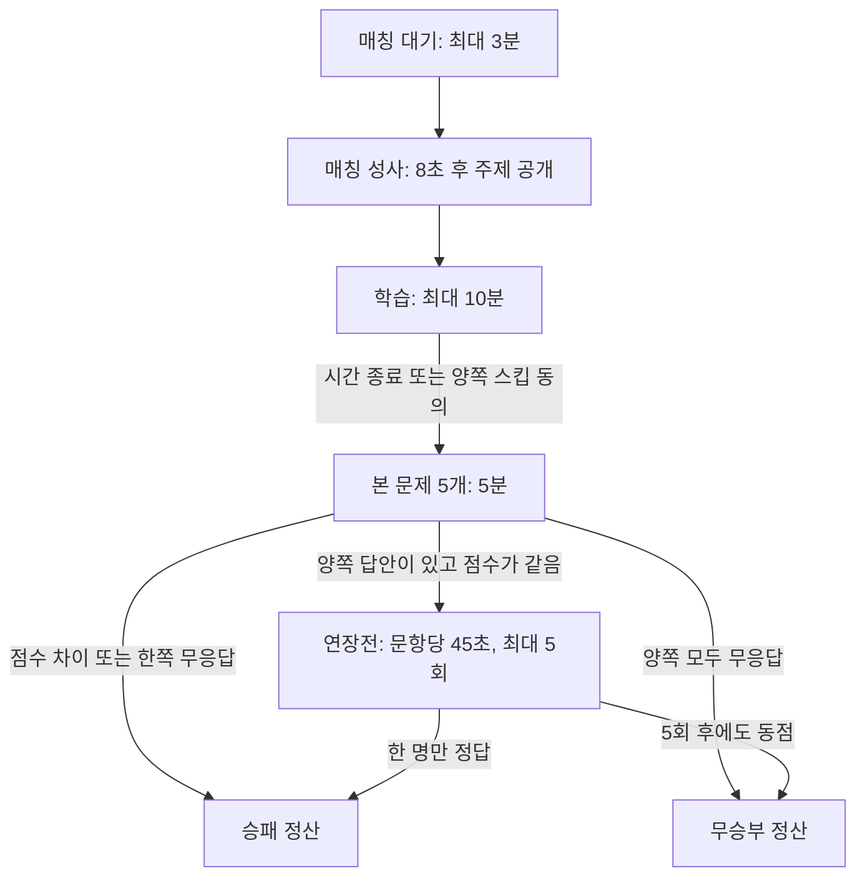

# 배틀 시스템 — 현재 규칙과 구현

최종 갱신: 2026-11-14

현재 코드에 구현된 동작을 설명하는 문서다. 향후 기능 제안이나 확정되지 않은 개발 계획을 나열하는 문서는 아니다. 전체 개발 상태는 [DEVELOPMENT_PROGRESS.md](DEVELOPMENT_PROGRESS.md), MySQL 전환·DB 구조는 [MYSQL_BACKEND_TRANSITION.md](MYSQL_BACKEND_TRANSITION.md)에서 관리한다.

## 1. 전체 구조와 역할

로그인한 두 회원이 공통 관심 주제로 학습하고, 같은 문제를 풀어 승패를 정하는 온라인 1:1 랜덤 배틀이다.

| 구분 | 역할 |
|---|---|
| 앱 | 화면·남은 시간 표시, 동의·답안·포기 요청, 서버 상태 갱신 |
| API 서버 | 사용자 확인, 상대·주제·문제 선택, 시간·채점·승패·배틀권·XP 정산 |
| MySQL | 매칭 대기·진행·답안·스킵 동의·결과·거래 내역 보관 |

서버가 관리하고 DB가 그 상태를 보관한다. 앱이 보낸 점수·누적 XP·사용자 ID를 그대로 믿고 승패나 보상을 결정하지 않는다.

- API 주소: `https://ppobgong.o-r.kr`
- Nginx가 HTTPS 요청을 내부 API 서버의 8788번 포트로 전달한다.
- API는 `ppobgong-api.service`로 상시 실행한다.
- 친구 기능과 배틀은 같은 로그인 인증을 사용하지만, **현재 랜덤 매칭에 친구 관계는 필요하지 않다.**
- 실제 상대가 대기열에 있어야 매칭된다. 대기자가 없으면 기다리는 상태를 유지한다.

## 2. 진행 순서와 기본 시간



| 항목 | 현재 규칙 |
|---|---|
| 매칭 대기 | 최대 180초 |
| 매칭 후 시작 대기 | 8초 |
| 학습 | 최대 600초. 두 명 모두 스킵에 동의하면 즉시 종료 |
| 본 문제 | 5문항, 제한 시간 300초 |
| 연장전 | 최대 5문항, 각 45초. 각 문항 시작 전 3초 대기 |
| 전체 문항 수 | 본 문제 5개 + 출제된 연장전 0~5개 = 5~10개 |
| 시간 추가 | 배틀에서는 제공하지 않음 |

실제 단계와 시작·종료 시각은 서버가 결정한다. 휴대폰 시계가 달라도 같은 시각에 진행하도록 앱이 서버 시각과의 차이를 보정한다. 네트워크와 화면 갱신 주기로 표시에는 약간의 차이가 생길 수 있다.

## 3. 매칭 대기열과 주제 선택

### 3.1. 신청과 중복 방지

1. 앱이 `requestId` UUID를 만들어 서버에 매칭을 요청한다.
2. 서버가 로그인·계정 상태·관심 분야·출제 가능한 주제·배틀권을 확인한다.
3. 배틀권을 예약하고 회원별 대기 행을 `match_entries`에 저장한다.
4. 조건이 맞는 상대를 찾으면 `battles`를 생성하고 두 대기 행을 같은 배틀에 연결한다.

응답을 받지 못한 요청은 같은 UUID로 재전송한다. 앱을 재실행해도 미응답 요청의 UUID를 복원한다. 같은 요청 때문에 배틀권을 다시 차감하지 않으며, 이미 대기 중이거나 진행 중인 배틀이 있으면 기존 상태를 반환한다.

DB에서도 회원당 활성 대기·매칭 행을 하나로 제한한다. 상대 연결과 배틀권 처리를 함께 저장하므로 동시에 여러 요청이 와도 같은 회원이 두 배틀에 들어가지 않도록 한다.

### 3.2. 상대를 고르는 조건

- 서버 DB에 저장된 `profiles.interests`를 사용한다. 앱이 임의로 보낸 주제 후보로 조건을 넓힐 수 없다.
- 관심 세부분야와 자격증에 연결된 세부분야·주제를 함께 확인한다.
- 분야·세부분야·주제가 활성 상태이고, 발행된 파일에 연결된 기본 문제가 10개 이상인 주제만 후보가 된다.
- 두 회원에게 공통으로 제공할 수 있는 주제가 있어야 한다.
- 기존 대기자 중 최근 15초 안에 대기 상태를 확인한 사람을 대상으로, 먼저 기다린 순서대로 호환되는 상대를 찾는다.
- 연결 직전에 기존 대기자의 현재 관심 분야와 출제 가능 주제를 다시 확인한다.
- 공통 주제 중 하나를 무작위로 선택한다.

현재는 관심 주제의 호환성과 대기 순서를 사용하는 방식이다. 회원 레벨·랭크·승률에 따른 실력 매칭은 적용하지 않는다.

### 3.3. 취소·이탈·만료

- 대기 취소는 특정 `entryId`를 지정한다. 예전 취소 요청이 뒤늦게 도착해 새 대기 신청을 취소하지 않게 한다.
- 매칭이 이미 성사됐다면 대기 취소 대신 연결된 배틀을 반환한다. 이후 중단은 배틀 포기 규칙을 따른다.
- 대기 시작 후 3분이 지나면 만료 처리하고 예약한 배틀권을 반환한다.
- 앱이 대기 상태 확인을 멈추면 최근 접속 조건에서 빠진다. 대기 행 자체는 바로 삭제되지 않으며, 만료 시 정리·반환한다.

## 4. 배틀권 처리

매칭을 신청하는 두 회원 모두 배틀권을 각각 1개 사용한다. 예약 시 무료권을 먼저 사용하고, 없으면 구매권을 사용한다. 서버에서 프리미엄으로 인정된 경우에는 무제한 경로가 있으나, 실제 프리미엄 결제·영수증 검증은 별도 미완료 기능이다.

| 항목 | 규칙 |
|---|---|
| 무료권 | 한국 시각 기준 매월 2개로 갱신. 이월 누적하지 않음 |
| 구매권 | 톱니바퀴 50개로 구매. 구매 시 보유 한도 5개 |
| 대기 취소·만료 | 사용한 종류의 권 반환 |
| 정상 완료·무승부·무응답 종료 | 반환하지 않음 |
| 명시적 포기 | 반환하지 않음 |
| 서버에서 무효 처리 | 예약권 반환, XP 미반영 |

무료권 반환은 예약한 달과 현재 달이 같을 때 최대 2개까지만 반영한다. 이전 달 무료권을 반환한다고 새 달의 무료권이 늘어나지는 않는다. 구매권 반환은 유실을 막기 위해 구매 한도를 일시적으로 초과할 수 있다.

예약·반환에는 대기 행별 고유 처리 키를 사용해 재전송에도 한 번만 반영한다. 이 상태는 `wallet_operations`와 연계해 서버에 보관한다.

## 5. 출제와 본 문제 풀이

### 5.1. 현재 문제 공급 방식

배틀의 AI 실연동은 보류 상태다. 현재는 서버의 기본 문제 은행에서 발행된 문제 10개를 무작위로 뽑아 배틀에 보존한다.

- 앞의 5개는 본 문제, 나머지 5개는 필요한 경우 사용하는 연장전 문제다.
- 같은 배틀 안에서 같은 문제 행을 중복 추출하지 않는다.
- 객관식은 보기 순서를 섞고 정답 위치도 함께 변환한다.
- 양쪽은 동일한 문제·출제 순서·보기 순서로 푼다.
- 주제는 매칭 직후 8초가 지난 학습 시작 시각에 공개한다.
- 본 문제는 퀴즈 시작 시각이 지나야 내려준다.
- 완료 전에는 정답·해설을 공개하지 않고 서버가 채점한다.

일반 학습의 문제 구성과 배틀 출제는 별도 규칙이다. 현재 배틀에 ‘AI 4개 + 기본 3개’ 구성을 적용하지 않는다.

### 5.2. 답안 저장과 제출

본 문제는 1번부터 순서대로 답안을 서버에 저장한다. 객관식 답은 보기 번호, OX 답은 boolean 값으로 전송한다.

- 저장된 같은 답안을 다시 보내면 기존 결과를 반환한다.
- 이미 저장된 문항을 다른 답으로 바꾸는 요청은 거절한다.
- 아직 학습 중이거나 풀이 시간이 끝났으면 새 답안을 받지 않는다.
- 5문항을 모두 답하면 자동 제출된다.
- ‘현재 답안으로 제출’을 누르면 일부만 답했어도 제출 상태가 된다.
- 미응답 문항은 정답으로 인정하지 않는다.
- 양쪽 모두 제출하거나 본 문제 제한 시간이 끝나면 승패를 판정한다.

앱이 보내는 최종 점수·누적 XP는 판정 근거로 사용하지 않는다. 요청 성공 여부가 불명확하면 같은 답을 재전송하고, 재접속 시 서버에 저장된 답안을 불러온다.

## 6. 학습 스킵

학습 화면의 위키 링크와 ‘배틀 포기’ 사이에 `학습 스킵 0/2` 버튼을 표시한다.

1. 한 명이 누르면 서버에 동의를 저장하고 `1/2`가 된다.
2. 동의한 사람이 다시 누르면 동의를 취소할 수 있다.
3. 두 명 모두 동의하면 서버가 즉시 학습을 종료한다.
4. 양쪽에 같은 퀴즈 시작 시각을 적용하고, 그 시각부터 풀이 시간 5분을 부여한다.

| 항목 | 구현 방식 |
|---|---|
| 동의 보관 | 기존 `battles.state_json`에 회원별 저장 |
| 요청 | 단순 반전 명령이 아닌 `{agree:true}` 또는 `{agree:false}` |
| 재전송 | 같은 동의를 여러 번 보내도 동의 수가 중복 증가하거나 반전되지 않음 |
| 화면 갱신 | 약 1초마다 서버 상태 확인. 실시간 푸시 방식은 아님 |
| 순서 역전 방지 | `revision`이 낮은 오래된 응답으로 최신 화면을 덮어쓰지 않음 |
| 사용 시점 | 학습 중에만 변경 가능. 시작 전에는 거절, 퀴즈 시작 후에는 단계·시간을 바꾸지 않음 |

두 번째 동의가 확정돼 퀴즈가 시작된 뒤에는 취소 요청이 도착해도 학습으로 되돌리지 않는다. 기록의 학습 시간에는 스킵 전 실제로 학습한 시간만 넣으며, 남은 10분이나 퀴즈 시간을 학습 시간에 더하지 않는다.

이 기능에는 추가 테이블이나 V6 마이그레이션이 필요하지 않았다. 양쪽 기기 모두 스킵 화면을 포함한 APK로 업데이트해야 사용할 수 있다.

## 7. 승패와 연장전

### 7.1. 본 문제 종료 시 판정

| 상황 | 결과 |
|---|---|
| 양쪽 모두 답안이 있고 정답 수가 다름 | 본 문제 정답 수가 많은 회원 승리 |
| 양쪽 모두 답안이 있고 정답 수가 같음 | 연장전 |
| 한쪽만 본 문제 답안을 1개 이상 저장 | 답안을 낸 회원 승리, 무응답 회원 패배 |
| 양쪽 모두 본 문제 답안이 없음 | 무승부 |

한쪽만 답안을 냈다면 그 답이 틀려 양쪽 점수가 0점이어도 무응답 판정을 먼저 적용한다. 반면 양쪽 모두 답안을 냈고 모두 틀렸다면 연장전으로 간다.

### 7.2. 연장전 판정

각 문항 시작 전 3초를 두고, 같은 문제를 45초 안에 푼다. 양쪽 모두 답했거나 제한 시간이 지나면 판정한다.

| 정답 여부 | 결과 |
|---|---|
| 한 명만 정답 | 그 회원 승리, 즉시 종료 |
| 둘 다 정답 | 다음 연장전 |
| 둘 다 오답·미응답 | 다음 연장전 |
| 최대 5회까지 승패가 나지 않음 | 무승부 |

연장전에서 미응답은 오답과 같이 정답이 아닌 것으로 처리한다. 본 문제의 한쪽 무응답 판정을 매 연장전에 다시 적용하지는 않는다.

연장전은 출제된 문항까지 기록한다. 1회 만에 끝났으면 총 6문항, 5회까지 갔으면 총 10문항이다.

## 8. 앱 종료·연결 끊김·포기·서버 장애

### 8.1. 개인의 연결 끊김

- 개인 통신 장애, 앱 닫기, 화면 이탈은 배틀 타이머를 멈추지 않는다.
- 별도의 ‘재접속 후 추가 N초’ 유예 시간은 없다.
- 해당 단계의 남은 시간 안에 복귀하면 저장된 답안·동의·현재 문제를 불러온다.
- 기한이 지났으면 서버가 확정한 다음 단계나 결과를 보여준다.
- 화면을 닫는 행위와 ‘배틀 포기’ 버튼을 누르는 행위는 다르다.

예를 들어 본 문제 풀이가 2분 남았을 때 30초 동안 연결이 끊겼다면, 복귀 후 약 1분 30초가 남는다. 연결이 끊긴 시간을 다시 더하지 않는다.

### 8.2. 명시적 포기

확인창에서 포기를 확정하면 서버가 즉시 상대를 승자로 정한다. 배틀권은 반환하지 않으며, 일반 패배와 같은 XP 이전 규칙을 적용한다. 포기자는 본 문제 답안을 일부 냈더라도 해당 배틀을 학습 실적으로 인정하지 않는다.

상대는 실제로 낸 본 문제 답안이 있어야 학습 실적으로 인정된다. 상대가 포기했다는 이유만으로 답안을 내지 않은 승자에게 학습 실적을 만들지는 않는다.

### 8.3. 서버의 무효 처리

참여 계정이 활성 상태가 아니거나 준비된 문제 묶음이 유효하지 않은 경우, 또는 퀴즈 시작 이후 마지막 진행 처리에서 30초를 초과한 공백이 감지되면 배틀을 무효 처리한다.

- 배틀권을 반환한다.
- XP를 이전하지 않는다.
- 완료 학습 기록은 만들지 않는다.
- 무효 배틀 자체는 배틀 이력에 남긴다.

API 프로세스는 약 5초마다 진행·만료를 정리하며 요청을 처리할 때도 상태를 확인한다. 서버 장애 판단은 이 처리 시각을 사용하는 현재 구현의 감지 규칙이며, 모든 장애 종류를 구분하는 완전한 장애 탐지 시스템은 아니다. 개인의 통신 장애를 곧바로 서버 장애로 간주하지 않는다.

## 9. 회원 XP·분야 랭크·학습 실적

### 9.1. 서로 다른 세 가지 기준

| 기준 | 의미 | 배틀에서의 반영 |
|---|---|---|
| 회원 XP | 회원 전체 레벨을 올리는 누적 경험치 | 승패에 따라 두 회원 사이에서 이전 |
| 분야 랭크 | 해당 분야의 누적 정답 수와 주제 수 기준 | 인정되는 본 문제 정답만 더함 |
| 학습일·학습 실적 | 공부한 날·횟수 등 학습 활동 표시 | 실제 답안을 낸 비포기자의 완료 기록을 반영 |

별도로 쌓는 ‘배틀 전용 XP’는 만들지 않는다. 분야 랭크도 회원 XP에서 나누어 지급하는 별도 잔액이 아니다.

### 9.2. XP 이전 계산

```text
이전 XP = min(
    100,
    floor(패자의 배틀 시작 시점 회원 XP × 0.05),
    정산 시점 패자의 남은 회원 XP
)

승자: +이전 XP
패자: -이전 XP
무승부: 0
```

| 패자 시작 XP | 정산 시 남은 XP | 이전 XP |
|---:|---:|---:|
| 1,000 | 1,000 | 50 |
| 3,000 | 3,000 | 100 |
| 19 | 19 | 0 |
| 1,000 | 30 | 30 |

회원 XP는 학습 XP 원장의 합계와 서버 확정 스피드 퀴즈 XP를 합쳐 계산한다. 승자가 얻는 양과 패자가 잃는 양은 같고, 배틀 정산 시 별도 일반 학습 XP·만점 보너스·첫 시도 보너스를 중복 지급하지 않는다. 패배로 누적 XP가 줄면 회원 레벨도 내려갈 수 있다. 이겼어도 계산된 이전 XP가 0이면 XP는 늘지 않는다.

### 9.3. 랭크와 학습 인정 조건

- **본 문제 답안을 1개 이상 저장했고 포기자가 아닌 회원**의 완료 기록을 학습 실적으로 인정한다. 만점이나 5문항 전부 응답이 필수인 것은 아니다.
- 정답 수는 분야 랭크에 합산하되, 연장전 정답은 랭크에서 제외한다.
- 포기자·무응답자의 기록은 남기지만 랭크 정답 수는 0이고 학습일로 인정하지 않는다.
- `study_date`는 인정되는 배틀의 서버 종료·정산 시각을 한국 날짜로 계산한다.
- 실제 학습 시간은 학습 시작부터 학습 종료 또는 조기 포기까지다. 시작 대기·퀴즈 시간은 제외한다.
- 일반 학습 퀘스트·일반 학습 반복 XP 계산에는 배틀을 넣지 않는다.

예를 들어 본 문제 4개와 연장전 2개를 맞혔다면 기록의 총 정답은 6개지만 분야 랭크에는 본 문제의 4개만 더한다.

## 10. DB 저장 구조

### 10.1. 매칭·진행 상태

| 테이블 | 저장하는 내용 |
|---|---|
| `match_entries` | 회원·요청 UUID·후보 주제·예약권 종류/월·대기/최근 접속/만료 시각·상태·배틀 연결 |
| `battles` | 참가자·주제·진행/완료/무효 상태·생성/종료 시각·진행 JSON |
| `wallet_operations` | 배틀권 예약·반환의 중복 처리 방지와 서버 보유 상태 |

`battles.state_json`에는 두 참가자 정보, 시작 시점 XP, 공통 문제·정답, 시작/종료 시각, 회원별 답안·제출 상태, 연장전, 스킵 동의, 결과·기록 ID, 최근 처리 시각·응답 버전을 보관한다. 정답을 포함한 내부 JSON을 그대로 앱에 공개하지 않고, 공개 가능한 필드만 응답한다.

`battles.status`와 화면 단계 `phase`는 다르다.

- DB 상태: `accepted`(진행 중), `finished`(정상 종료), `void`(무효).
- 화면 단계: `countdown`, `study`, `quiz`, `submitted`, `overtime`, `finished`, `void`.
- 대기 행 상태: `waiting`, `matched`, `canceled`, `expired`, `completed`, `invalid`.

### 10.2. 일반 학습과 공통으로 쓰는 기록

배틀 전용 문항별 상세 테이블을 새로 만들지 않고 기존 풀이 구조를 재사용한다.

| 테이블·필드 | 역할 |
|---|---|
| `quiz_attempts` | 회원별 한 번의 풀이 |
| `quiz_attempt_items` | 문제 ID·당시 문제/보기/정답/해설·사용자 답안·채점 결과·출제 순서 |
| 문항 스냅샷의 `stage` | `main` 또는 `overtime` 구분 |
| `study_records.study_type` | `study` 또는 `battle` |
| `study_records.battle_id` | 공통 승부와 회원별 기록 연결 |
| `study_records.quiz_total` | 본 문제와 출제된 연장전을 합한 전체 문항 수 |
| `study_records.score` | 본 문제와 연장전을 합한 실제 정답 수 |
| `study_records.rank_score` | 학습 인정 조건을 충족한 본 문제 정답 수. 미인정이면 0 |
| `study_records.rp` | 이번 승부의 XP 증감. 배틀은 -100~100 |
| `xp_ledger.source_type` | 일반 학습과 배틀 XP 원장 구분 |
| `user_sync_states` | 다른 기기에서 새 결과를 가져올 수 있도록 동기화 순번 갱신 |

승부 하나가 정상 종료되면 회원별 기록이 각각 하나씩, 총 2개 생긴다. 무승부·포기·무응답도 결과 기록을 만들며, 무효는 완료 학습 기록을 만들지 않는다.

배틀 결과는 최근 배틀 목록과 일반/배틀 필터가 있는 공통 학습 기록에서 확인한다. 승패와 양쪽 XP가 연결돼 있으므로 배틀 기록의 개별 삭제는 차단하고 메모 수정은 허용한다.

### 10.3. 원자적 저장과 누적 관리

양쪽 기록·문항별 답안·XP 원장·동기화 순번·대기 종료를 한 트랜잭션으로 확정한다. 중간 저장이 실패하면 함께 되돌리고, 완료 요청을 반복해도 기록이나 XP를 다시 만들지 않는다.

현재는 DB 단위 잠금과 일정한 순서의 회원 행 잠금으로 동시 매칭·정산을 보호한다. 대규모 동시 접속에 대한 부하 검증과 잠금 범위 최적화는 아직 수행하지 않았다.

대기 행은 **매칭 성사 때가 아니라 매칭 신청 때** 만든다. 일반적으로 두 회원의 한 배틀에는 대기 행 2개가 연결된다. 취소·만료 행도 상태를 바꿔 보존하며 동일 요청 재전송으로 새 행을 만들지는 않는다.

종료된 대기·배틀 행을 오래됐다는 이유로 자동 삭제하는 주기 작업은 없다. 계정 삭제에 따른 FK 정리와 별개로, 보존 기간·오래된 행 정리·백업·용량 정책은 아직 확정하지 않았다.

## 11. 핵심 API와 요청 제한

모든 아래 요청은 로그인 토큰을 사용한다. 서버가 토큰에서 회원을 식별하고 참여·소유권을 확인한다.

| 요청 | 동작 |
|---|---|
| POST `/match` `{requestId}` | 배틀권 예약·대기 등록·상대 연결 |
| GET `/match` | 대기 상태·현재 배틀·대기 접속 표시 갱신 |
| DELETE `/match` `{entryId}` | 특정 대기 취소 |
| GET `/battles/inbox` | 현재 배틀 확인 |
| GET `/battles/history` | 본인의 최근 완료·무효 배틀 최대 50개 |
| GET `/battles/:id` | 현재 단계·시각·본인 답안·동의 수·결과 |
| POST `/battles/:id/study-skip` `{agree}` | 학습 스킵 동의·취소 |
| POST `/battles/:id/answers` `{position,answer}` | 본 문제 답안 저장 |
| POST `/battles/:id/result` | 현재까지 답안으로 제출 |
| POST `/battles/:id/overtime` `{round,answer}` | 연장전 답안 저장 |
| POST `/battles/:id/forfeit` | 명시적 포기 |

배틀 화면은 서버 상태를 약 1초마다 확인하며 갱신 요청이 겹치지 않게 한다. 네트워크 전송 자체를 실시간 푸시 방식으로 구현한 것은 아니다.

초기 구현에서는 모든 API 요청 전에 `/auth/me`를 추가 호출했고, Nginx 연결 주소별 인증 확인 한도를 두 기기가 공유해 429가 발생했다. 현재는 대상 API가 토큰·계정을 직접 검증하도록 중복 사전 요청을 제거했다. 앱의 로그인 복원·명시적 확인·토큰 만료/401 갱신은 유지한다.

- `/auth/me`: 검증된 회원별 분당 600회. 잘못된 토큰은 주소별 제한을 적용한다.
- 로그인·가입 요청의 기존 제한은 유지한다.
- 배틀 경로에는 별도로 연결 주소별 분당 600회 제한이 있다. 인증 확인 제한과 같은 규칙으로 변경한 것은 아니며, 다수 동시 접속 환경에서의 조정·검증은 남아 있다.
- 요청 제한·통신 실패·DB 연결 지연은 구분된 안내 문구로 표시한다.

## 12. 적용·검증 상태와 코드 위치

### 현재 적용 상태

- 운영 RDS와 로컬 개발 DB 모두 V5 적용·검증 완료. V1~V5 이력·체크섬이 일치한다.
- 스킵과 인증 요청 제한 수정은 운영 API에 반영 완료. 이 두 수정에는 새 마이그레이션이 없다.
- 콘텐츠 탭 스크롤과 하단 바로가기 잘림·중복 안전 여백을 수정하고 에뮬레이터에서 확인했다. 배틀 시간·승패·보상 규칙은 변경하지 않았다.
- 릴리스 APK 재생성·전용 서명 검증 완료. 두 기기에 최신 APK를 설치해야 앱 측 수정까지 적용된다.
- 사용자 확인: 휴대폰과 에뮬레이터 간 친구 신청·배틀 진입 정상 동작. 모든 종료·장애 상황을 두 실기기에서 확인했다는 의미는 아니다.

EC2의 배틀·스킵·인증 한도 회귀 검사 파일도 최신 로컬본으로 맞췄다. 전체 소스 비교 범위와 운영 반영 내역은 개발 진행 현황에서 관리한다.

### 자동·운영 검사

- 통합 검사 124개, 앱 검사 27개 통과. 두 집계에는 공통 검사도 있으므로 단순 합산하지 않는다.
- 매칭 중복·동시 요청·소유권·재전송·답안 복원·포기·무응답·연장전·XP 1회 정산·정산 실패 시 전체 롤백 검사.
- 스킵 동의 복원·취소·동시 합의·잘못된 형식/권한·시각 고정·실제 학습 시간 검사.
- 운영 HTTPS의 임시 격리 배틀로 양쪽 스킵 전환을 확인하고 테스트 계정을 정리. 실제 매칭 대기열에 테스트 계정을 넣지 않음.
- 운영 HTTPS 두 임시 계정의 인증 확인 150회에서 429 없음 확인. 로컬 제한 검사에서 같은 주소의 서로 다른 회원 한도 분리·같은 회원의 다른 토큰 한도 공유도 확인.
- 부정행위 전체 차단이나 대규모 부하 검증 완료를 의미하지 않는다. 기본 문제는 일반 문제 API로도 제공되므로, 정답을 미리 알아내는 모든 행위를 막는 구조는 아니다.

### 구현 파일

| 파일 | 역할 |
|---|---|
| [battle-service.mjs](../api/mysql/battle-service.mjs) | 매칭·출제·시간·스킵·답안·승패·기록·XP 정산 |
| [battle-http.mjs](../api/mysql/battle-http.mjs) | 배틀·매칭 HTTP 경로와 요청 제한 |
| [wallet-state.mjs](../api/mysql/wallet-state.mjs), [member-service.mjs](../api/mysql/member-service.mjs) | 권 보유 상태·구매·회원 재화 연결 |
| [record-service.mjs](../api/mysql/record-service.mjs) | 공통 기록 읽기·동기화·메모·삭제 정책·집계 |
| [V5__battle_matching.sql](../api/mysql/migrations/V5__battle_matching.sql) | 배틀/대기열 테이블과 공통 기록·XP 제약 확장 |
| [battle.tsx](../app/src/app/battle.tsx) | 학습·스킵·풀이·결과·복귀 화면 |
| [arena.tsx](<../app/src/app/(tabs)/arena.tsx>) | 매칭 신청·취소·진행 배틀 복귀·최근 결과 |
| [social.ts](../app/src/lib/social.ts) | 배틀 API 호출·응답 타입·서버 시각 보정 |
| [auth-client.ts](../app/src/lib/auth-client.ts), [auth-http.mjs](../api/server/auth-http.mjs) | 토큰 갱신·로그인 확인·회원별 인증 요청 제한 |
| [battle-test.mjs](../api/mysql/battle-test.mjs) | 실제 MySQL 기반 배틀 통합 검사 |

이 문서는 배틀 규칙의 상세 설명을 담당한다. 구현이 변경되면 관련 단원 전체를 갱신하고, 완료·미완료 상태와 전체 검증 수치는 개발 진행 현황에 함께 반영한다.
